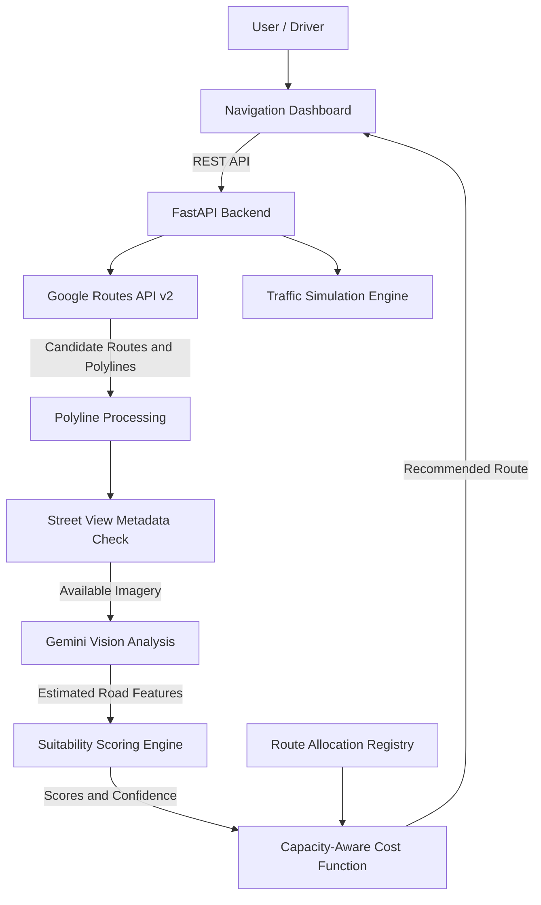

# FlowSplit

### Capacity-Aware, AI-Assisted Geospatial Routing

FlowSplit is a geospatial routing project that explores how road suitability and traffic capacity can be considered alongside travel time when selecting routes.

A route that saves a few minutes on paper may send drivers through narrow residential streets, roads with limited usable width, or corridors with significant parking and pedestrian conflicts. FlowSplit evaluates these characteristics and incorporates them into a multi-factor route-selection process.

The system combines Google Routes API, Street View imagery, Gemini vision analysis, a deterministic road-scoring engine, and capacity-aware route selection. It also includes a traffic simulation lab for comparing routing strategies under different demand conditions.

> **Project focus:** Moving beyond route-by-route travel-time optimization toward routing decisions that account for road suitability and network-level traffic distribution.

---

## Features

- **Road-suitability scoring:** Converts estimated road characteristics into a consistent score from 0 to 100.
- **AI-assisted road inspection:** Uses Gemini vision to estimate relevant characteristics from available road imagery.
- **Traffic-aware route candidates:** Retrieves candidate routes and travel-time estimates through Google Routes API.
- **Capacity-aware route selection:** Combines travel time, suitability, congestion penalties, and confidence in a route cost function.
- **Uncertainty handling:** Accounts for missing or uncertain road attributes instead of treating every estimate as reliable.
- **Route allocation and hysteresis:** Tracks route allocations and helps prevent unnecessary changes in recommendations.
- **Traffic simulation:** Provides a benchmark environment for comparing routing strategies under different demand and capacity assumptions.
- **Offline testing:** Supports automated tests without requiring billable external API calls.

## System Architecture



### Routing pipeline

1. The user supplies an origin and destination.
2. The backend requests candidate routes from Google Routes API.
3. Route polylines are decoded and sampled at selected intervals.
4. Street View metadata is checked to determine whether imagery is available.
5. Eligible images are analyzed by Gemini to estimate road characteristics.
6. The scoring engine converts those estimates into suitability scores.
7. The routing engine evaluates travel time, road suitability, congestion, and uncertainty.
8. The selected recommendation is returned to the frontend.

The simulation engine provides a separate environment for evaluating routing behavior under modeled traffic demand. Simulation outputs should be distinguished from measurements collected on real roads.

---

## How Route Selection Works

### 1. Deterministic road-suitability scoring

FlowSplit combines several road characteristics into a single suitability score.

\[
S = 0.35W + 0.25P + 0.20D + 0.20L
\]

Where each component is normalized to a scale of 0–100:

| Component | Weight | What it represents |
|---|---:|---|
| \(W\) | 35% | Usable road width |
| \(P\) | 25% | Curbside parking and obstruction friction |
| \(D\) | 20% | Pedestrian exposure and road context |
| \(L\) | 20% | Lane characteristics and connectivity |

The weights express the relative importance assigned to each component by the scoring policy.

The scoring engine is deterministic: given the same processed feature values and configuration, it should produce the same score. Gemini supplies estimated visual attributes; it does not independently decide the final route.

Unknown features are handled through uncertainty penalties and confidence adjustments, according to the implemented scoring rules.

### 2. Capacity-aware route selection

The route-selection engine evaluates candidates using a multi-factor cost function:

\[
J(R) =
C_{\text{time}} +
C_{\text{congestion}} +
C_{\text{unsuitable}} +
C_{\text{uncertainty}}
\]

The components represent:

- **Travel time:** Estimated duration for the candidate route.
- **Road unsuitability:** A penalty for traversing roads with lower suitability scores.
- **Congestion:** A penalty based on the modeled or estimated traffic conditions.
- **Uncertainty:** A penalty for low confidence in the available road assessments.

For example, the suitability penalty can be expressed as a length-weighted average:

\[
C_{\text{unsuitable}} =
\beta \sum_{i}
\left(100-S_i\right)
\frac{\ell_i}{\ell_R}
\]

Here, \(S_i\) is the suitability score for segment \(i\), \(\ell_i\) is its length, and \(\ell_R\) is the total route length.

The travel-time term can be written as:

\[
C_{\text{time}} = \alpha T_R
\]

The coefficients determine the relative influence of each objective. Their actual values and the precise congestion and confidence calculations should be taken from the implementation.

The selected route is the lowest-cost candidate under the configured objective and any applicable constraints. It is not necessarily the shortest-distance route.

### 3. Congestion modelling

The simulation can use a volume-to-capacity ratio:

\[
r = \frac{V}{C}
\]

Where \(V\) is traffic volume and \(C\) is the estimated capacity of a road segment over the same time interval.

A common model for estimating congestion-related travel-time growth is the Bureau of Public Roads (BPR) function:

\[
T = T_0\left[1+a\left(\frac{V}{C}\right)^b\right]
\]

Here, \(T_0\) is free-flow travel time, and \(a\) and \(b\) are model parameters.

The BPR equation is a standard traffic-modelling approach. Its use in a simulation does not imply that live road capacities are directly supplied by Google Routes API.

### 4. Route allocation and hysteresis

The allocation registry tracks route recommendations and helps avoid repeatedly switching between similar candidates.

The intended behavior is to change a recommendation only when the alternative offers a sufficient improvement under the configured cost function. This helps stabilize route choices and can reduce unnecessary recommendation changes.

Coordinated allocation can only influence the vehicles or trips managed by FlowSplit; it cannot directly control all traffic using Google Maps.

---

## Technology Stack

| Layer | Technologies |
|---|---|
| Frontend | HTML5, CSS, JavaScript |
| Mapping | Google Maps JavaScript API |
| Backend | Python 3.12+, FastAPI |
| Validation and configuration | Pydantic, Pydantic Settings |
| Route generation | Google Routes API v2 |
| Road imagery | Google Street View Static API |
| Vision analysis | Gemini API, `google-genai` Python SDK |
| Geospatial processing | Polyline decoding, coordinate sampling, route-segment analysis |
| Simulation | Capacity-aware routing and traffic-model components |
| Testing | pytest |

The application can also provide a canvas-based map fallback if that capability is enabled in the current frontend configuration.

---

## Getting Started

### Prerequisites

- Python 3.12 or later
- Git
- Google Cloud project with the required Maps Platform APIs enabled
- Gemini API access for vision-based analysis

### 1. Clone the repository

Replace the placeholder URL with the repository's actual clone URL.

```bash
git clone <repo-url>
cd gdg_split
```

### 2. Create a virtual environment

```bash
python3 -m venv .venv
source .venv/bin/activate

python -m pip install --upgrade pip
pip install -r requirements.txt
```

### 3. Configure environment variables

Copy the example configuration:

```bash
cp .env.example .env
```

Add your own credentials and configuration values to `.env`:

```dotenv
GOOGLE_MAPS_BROWSER_KEY=your_browser_key
GOOGLE_MAPS_JS_API_URL=https://maps.googleapis.com/maps/api/js

GOOGLE_ROUTES_API_KEY=your_routes_server_key
GOOGLE_ROUTES_API_URL=https://routes.googleapis.com/directions/v2:computeRoutes

GOOGLE_STREET_VIEW_API_KEY=your_street_view_server_key
GOOGLE_STREET_VIEW_METADATA_URL=https://maps.googleapis.com/maps/api/streetview/metadata
GOOGLE_STREET_VIEW_IMAGE_URL=https://maps.googleapis.com/maps/api/streetview

GEMINI_API_KEY=your_gemini_api_key
GEMINI_MODEL=gemini-3.5-flash
GEMINI_API_URL=https://generativelanguage.googleapis.com
```

These values reflect the documented configuration names; check `.env.example` and the application settings for the exact variables required by your current checkout.

The model name above is an example based on the original configuration. Use a model identifier that is available to your Gemini API account and supported by the installed SDK.

**Keep credentials private.** Do not commit `.env` or expose server-side keys through frontend JavaScript, API responses, screenshots, or logs.

### 4. Start the backend

Run the command from the repository root:

```bash
source .venv/bin/activate

uvicorn backend.app.main:app \
  --host 0.0.0.0 \
  --port 8000 \
  --reload
```

Open the application at:

http://localhost:8000

If the frontend is served separately in your setup, start it using the project's configured frontend server instead.

---

## Using FlowSplit

### Live route analysis

1. Open the dashboard.
2. Enter an origin and destination, or use the GPS option to obtain your current location.
3. Request candidate routes.
4. Allow the backend to process route geometry and check Street View availability.
5. Run the road-analysis and route-selection workflow.
6. Review the route recommendation and the available suitability and cost information.

Live analysis requires valid API credentials, enabled services, and available imagery. Not every road segment has Street View coverage, and visual estimates should not be treated as surveyed measurements.

### Traffic Simulation Lab

1. Open **Simulation Lab**.
2. Configure the trip demand and simulation parameters.
3. Run the simulation.
4. Compare the baseline and FlowSplit results using the metrics exposed by the implementation.

Useful evaluation metrics include average journey time, total network travel time, queue length, overloaded road segments, and traffic distribution across residential and arterial roads.

Simulation results depend on the road network, demand assumptions, capacity estimates, and model parameters. They should not be presented as real-world traffic measurements unless independently validated.

---

## API Reference

The following table documents the project's intended API surface. Verify each route and its HTTP method against the current FastAPI application before relying on it.

| Method | Endpoint | Purpose |
|---|---|---|
| `GET` | `/health` | Health status and API capability information |
| `GET` | `/api/config/public` | Public frontend configuration |
| `POST` | `/api/routes/candidates` | Request candidate routes |
| `POST` | `/api/routes/analyze` | Analyze routes and score road suitability |
| `POST` | `/api/routes/select` | Select a route using the cost function |
| `POST` | `/api/roads/analyze` | Analyze a road location |
| `GET` | `/api/roads/{road_id}` | Retrieve a road analysis record |
| `GET` | `/api/routes/analysis/{id}` | Retrieve a route analysis record |
| `POST` | `/api/simulation/run` | Run a baseline-versus-FlowSplit simulation |

For the available request schemas, response formats, and interactive endpoint documentation, open:

http://localhost:8000/docs

---

## Testing

Run the automated test suite from the repository root:

```bash
source .venv/bin/activate
pytest backend/tests -v
```

Tests should cover the deterministic scoring logic, route selection, congestion modelling, API behavior, and configuration or security handling where corresponding test cases exist.

For reproducible tests, mock external API responses and keep tests independent of live Google Maps and Gemini services.

---

## Security and Cost Considerations

- **Restrict browser keys:** Limit the Maps JavaScript API key to the required APIs and permitted HTTP referrers.
- **Protect server credentials:** Keep Routes API, Street View, and Gemini credentials on the backend.
- **Validate public configuration:** Return only values the frontend needs; never expose server-side secrets.
- **Bound image sampling:** Limit the number of images inspected per route and configure request and spending budgets.
- **Handle missing imagery:** Skip unavailable Street View images and preserve uncertainty in the scoring process.
- **Sanitize errors:** Return useful error messages without exposing credentials, stack traces, or internal implementation details.
- **Review API terms:** Confirm that the planned use of Street View imagery, external AI processing, retention, and caching complies with the applicable provider terms.
- **Monitor usage:** Set billing budgets, usage alerts, quotas, and API restrictions.

---

## Current Scope and Limitations

FlowSplit is an experimental routing system, not a replacement for a production navigation service.

Its results depend on candidate-route availability, the quality and coverage of road imagery, the accuracy of estimated road attributes, and the assumptions used in the capacity model.

In particular:

- Google Routes API supplies candidate routes and routing information; FlowSplit adds its own scoring and selection policy.
- Gemini-derived road attributes are estimates, not guaranteed measurements.
- Traffic capacity and queue estimates depend on the available inputs and simulation assumptions.
- Coordinated routing affects only participating trips.
- Any claimed improvement over existing navigation should be established through reproducible experiments against a traffic-aware baseline.

## Project Goal

The goal is to investigate whether road-suitability information and capacity-aware allocation can improve how vehicles are distributed across a road network—especially when narrow or residential roads compete with more suitable corridors for through-traffic.

**FlowSplit explores a simple question: can routing decisions account for the road itself, not just the time it takes to cross it?**
